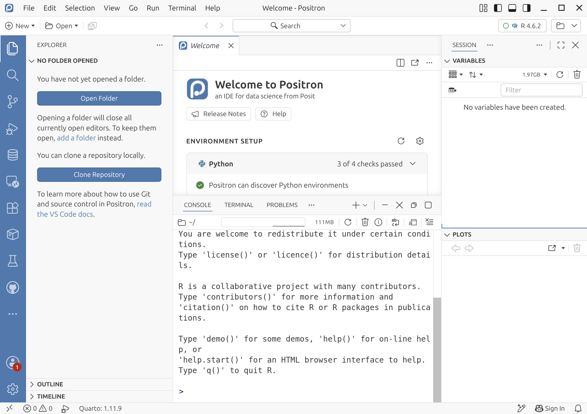
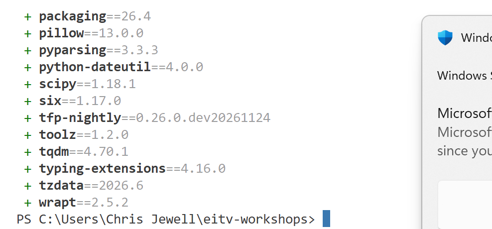
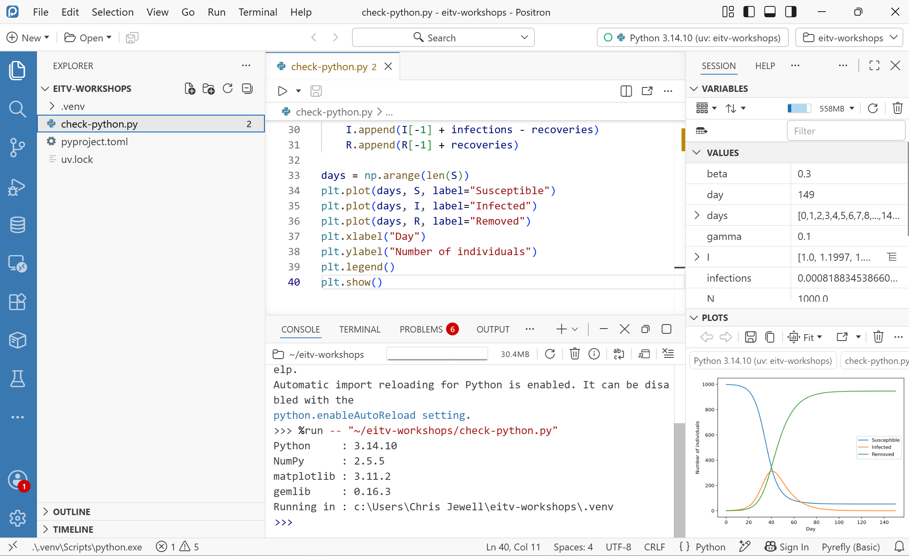

.. _python-positron-setup:

================================================
Getting started: Python and Positron for R users
================================================

.. Instructor notes
   ----------------
   * Total running time: ~20 minutes. Timings are given in each section heading.
   * Send the "Before the workshop" section to participants a few days in
     advance. Downloading Positron, uv, Python 3.14 and gemlib's JAX
     dependencies on conference Wi-Fi is the main risk to timing.
   * The one thing that MUST go right is participants choosing Python 3.14
     when creating the environment. It's flagged at the point of choice, and
     check_setup.py refuses to pass on any other version.
   * This page uses the ``sphinx-design`` extension for the operating-system
     tabs. Add ``"sphinx_design"`` to ``extensions`` in ``conf.py``.
   * Screenshots live in ``_static/positron/``. Replace the placeholder
     figures with grabs from the current Positron release before teaching.

**Aims of this session.** By the end you will have:

* a working installation of the Positron IDE, with Python 3.14 installed
  for you by the ``uv`` project manager;
* an understanding of what a *virtual environment* is and why we always use one;
* a project called ``eitv-workshop``, with its own virtual environment
  containing NumPy, matplotlib and gemlib, ready for the epidemic modelling
  workshops that follow.

.. list-table:: Session plan
   :header-rows: 1
   :widths: 15 85

   * - Time
     - Activity
   * - 0--3 min
     - What is Python, and how does it relate to R?
   * - 3--7 min
     - Installing Positron (check your pre-workshop install)
   * - 7--11 min
     - Virtual environments: what and why
   * - 11--15 min
     - Creating the ``eitv-workshop`` project (with Python 3.14!)
   * - 15--18 min
     - Adding NumPy, matplotlib and gemlib
   * - 18--20 min
     - Checking everything works

Before the workshop
===================

Please do these steps **before** the session if you possibly can. They take
10--15 minutes, mostly waiting for downloads.

1. Install Positron (see :ref:`install-positron`).
2. If you are feeling adventurous, carry on and work through the rest of this
   page. If anything goes wrong, don't worry: we'll sort it out together.

.. note::

   You don't need to install Python yourself. Positron will download it
   for you, using uv, when we create the project. We use **Python 3.14**
   throughout the workshop series. If you already have Python on your
   computer, that's fine: it won't be touched.

What is Python? (3 minutes)
===========================

Python is a general-purpose programming language. Like R, it is free, open
source and widely used for data analysis and statistics. Where R was designed
by statisticians for statistics, Python was designed as a general programming
language, and its scientific capabilities come from add-on *packages*.

For this workshop series, the important point is that the epidemic modelling
library we'll be using, **gemlib**, is written in Python. It builds on
JAX, which gives us fast compiled computation, automatic differentiation and
the option of running on GPUs.

If you know R, you already know most of the *ideas* you need. Many things have
a direct equivalent:

.. list-table:: Rosetta stone: R and Python
   :header-rows: 1
   :widths: 40 30 30

   * - Concept
     - R
     - Python
   * - Package repository
     - CRAN
     - PyPI (the Python Package Index)
   * - Add a package to a project
     - ``install.packages("dplyr")``
     - ``uv add numpy``
   * - Load a package
     - ``library(dplyr)``
     - ``import numpy as np``
   * - Use a function from a package
     - ``dplyr::filter()``
     - ``np.mean()``
   * - Per-project package library
     - ``renv``
     - virtual environment, managed by ``uv``
   * - Rebuild a project's packages
     - ``renv::restore()``
     - ``uv sync``
   * - Arrays and maths
     - built in
     - NumPy
   * - Plotting
     - base graphics / ggplot2
     - matplotlib
   * - IDE
     - RStudio
     - Positron (also does R!)

Two differences that trip up R users:

* **Python counts from 0**, not 1. The first element of ``x`` is ``x[0]``.
* **Indentation matters.** Python uses indentation, not curly braces, to group
  lines of code together.

**What is Positron?** Positron is a data science IDE made by Posit, the
company behind RStudio. It feels familiar to RStudio users (console, plots
pane, variables pane, editor) but works equally well with R and Python. You
can keep using it for your R work too.

**What is uv?** uv is a small, fast tool that installs Python itself, creates
virtual environments and installs packages into them. It replaces several
older tools with one. Positron uses uv behind the scenes, and will download it
for you the first time it's needed.

.. _install-positron:

Installing Positron (part of 4 minutes)
=======================================

1. Go to https://positron.posit.co/ and click **Download**.
2. Download the installer for your operating system and run it as you would
   any other application.

   * **Windows:** use the user-level installer (no administrator rights
     needed).
   * **macOS:** open the ``.dmg`` and drag Positron into *Applications*.
   * **Linux:** use the ``.deb`` (Ubuntu/Debian) or ``.rpm`` (Fedora/RHEL)
     package.

3. Start Positron. You should see a welcome page, and it will look broadly
   like RStudio: an editor, a console, and panes for variables, plots and
   help.

         side panes.
   :width: 90%

   Positron on first launch. If you have used RStudio, the layout should feel
   familiar.

Virtual environments: what and why (4 minutes)
==============================================

The problem
-----------

When you run ``install.packages()`` in R, the package goes into a single
library shared by every R project on your computer. Usually that's fine, until
project A needs version 1 of a package and project B needs version 2.

Python has exactly the same problem, but worse:

* Python packages tend to depend on very *specific* versions of each other.
  gemlib, for example, needs particular versions of JAX, which in turn needs
  particular versions of NumPy.
* **On macOS and Linux, the operating system itself uses Python.** System
  tools rely on the Python that came with the computer. If you install or
  upgrade packages in that Python, you can break parts of your operating
  system. Modern Linux distributions and Homebrew now *refuse* to let you do
  this, and you'll see an ``externally-managed-environment`` error if you try.

The solution
------------

A **virtual environment** is a private, self-contained copy of Python with its
own set of packages, living inside a folder in your project. It's the Python
equivalent of ``renv`` in R.

Positron and uv create and look after the virtual environment for you. Our
project will look something like this:

.. code-block:: text

   eitv-workshop/           <- your project folder
   ├── .venv/               <- the virtual environment (uv manages this)
   ├── .python-version      <- which Python version the project uses
   ├── pyproject.toml       <- the packages the project needs
   ├── uv.lock              <- the exact versions installed (like renv.lock)
   └── check_setup.py       <- your code

The rules of thumb are simple:

1. **One virtual environment per project.** uv puts it in a folder called
   ``.venv`` inside the project.
2. **Add packages with** ``uv add``, never with ``pip install``. That way uv
   records each package in ``pyproject.toml`` and ``uv.lock``.
3. **The environment is disposable.** If it gets into a mess, delete the
   ``.venv`` folder and run ``uv sync``. uv rebuilds it exactly from
   ``uv.lock``. Your code is never stored in it.
4. **Don't share or sync** ``.venv``. Share ``pyproject.toml`` and ``uv.lock``
   instead; ``uv sync`` rebuilds the environment on any computer in a minute
   or two.

.. warning::

   **Windows users:** your *Documents* folder is often synced to OneDrive.
   Virtual environments contain thousands of small files, and syncing them
   causes slow-downs and odd errors. Put the project somewhere that is *not*
   synced. The instructions below use a ``projects`` folder in your home
   directory, which is fine.

Creating the ``eitv-workshop`` project (4 minutes)
==================================================

We'll create one project now and use it for all the epidemic modelling
workshops that follow.

1. In Positron, choose **File → New Folder from Template…**.
2. Choose the **Python Project** template and click *Next*.

   .. figure:: ../_static/positron/new-folder-template.png
      :alt: Positron's "New Folder from Template" dialog, with the Python
            Project template selected.
      :width: 70%

      Choose the *Python Project* template.

3. Set the folder name to ``eitv-workshop`` and choose where to put it (see
   the OneDrive warning above). Click *Next*.
4. On the Python environment screen, choose **Create a new environment** and
   set the environment type to **uv**.
5. If uv isn't installed yet, Positron offers to download it. **Install uv** Once
   uv is installed, the list of Python versions becomes available.

   .. figure:: ../_static/positron/new-folder-environment.png
      :alt: Positron offering to download uv after the uv environment type
            has been selected.
      :width: 70%

      Positron offers to download uv for you. Say yes.

6. Choose **Python 3.14** from the list of versions.

   .. danger::

      **You must choose Python 3.14** or `gemlib` will not install.
      Read the version number carefully
      before you click *Create*. Everything in the workshops that follow
      depends on it, and choosing the wrong version is the most common
      reason for things not working later.

   .. figure:: ../_static/positron/new-folder-environment1.png
      :alt: The environment screen of the new folder dialog, showing
            "Create a new environment", type uv, and Python 3.14 selected.
      :width: 70%

      Environment type **uv**, Python version **3.14**.

7. Click *Create*. Positron downloads Python 3.14 if necessary, creates the
   ``eitv-workshop`` folder with its virtual environment, opens it (possibly
   in a new window), and starts a Python console.

8. **Check the version now.** Look at the session selector in the top-right of
   the window: it should say **Python 3.14** with ``.venv`` (or
   ``eitv-workshop``) next to it. If it shows any other version, stop and see
   :ref:`wrong-python-version` before going any further.

   .. figure:: ../_static/positron/session-selector.png
      :alt: The Positron session selector showing the project's .venv
            Python 3.14 interpreter as the active session.
      :width: 50%

      The session selector must show **Python 3.14** from your project's
      ``.venv``.

Adding packages (3 minutes)
===========================

.. warning::
   You may need to close and re-open Positron to finalise the `uv` setup.
   Try this if you get errors below.
  
1. Open a terminal with **Terminal → New Terminal**. It appears in the bottom
   pane, next to the console, and starts inside the ``eitv-workshop`` folder.
2. Add the packages the workshops need:

   .. code-block:: console

      $ uv add numpy matplotlib gemlib

   This single command:

   * works out a set of package versions that are compatible with each other
     and with Python 3.14;
   * installs them into the project's ``.venv``;
   * records them in ``pyproject.toml`` and ``uv.lock``.

         installed packages.
   :width: 80%

   ``uv add`` installs everything in one go.

.. note::

   gemlib pulls in JAX and its compiled components, which are a sizeable
   download. The install may take a few minutes. This is a one-off cost.

Later, if you need another package, run ``uv add <package-name>`` in the
terminal in the same way. To remove one, use ``uv remove <package-name>``.

.. warning::

   Don't use ``pip install`` or ``%pip install`` in this project. uv's
   environments don't include pip, so you'll get a ``No module named pip``
   error. More importantly, packages installed that way aren't recorded in
   ``uv.lock``, so they would disappear the next time the environment is
   rebuilt.

Checking everything works (2 minutes)
=====================================

Create a new Python file (**File → New File… → Python File**), paste in the
code below, and save it as ``check_setup.py`` in the project folder.

.. code-block:: python
   :caption: check_setup.py

   """Check that the eitv-workshop environment is set up correctly."""

   import sys
   from importlib.metadata import version

   import numpy as np
   import matplotlib.pyplot as plt
   import gemlib

   if sys.version_info[:2] != (3, 14):
       raise SystemExit(
           f"WRONG PYTHON VERSION: this is Python {sys.version.split()[0]}, "
           "but the workshops need Python 3.14. "
           "See 'Wrong Python version' in the troubleshooting section."
       )

   print(f"Python     : {sys.version.split()[0]}")
   print(f"NumPy      : {version('numpy')}")
   print(f"matplotlib : {version('matplotlib')}")
   print(f"gemlib     : {version('gemlib')}")
   print(f"Running in : {sys.prefix}")

   # A tiny deterministic SIR model, just to make a plot
   beta, gamma, N = 0.3, 0.1, 1000.0
   S, I, R = [N - 1.0], [1.0], [0.0]
   for day in range(150):
       infections = beta * S[-1] * I[-1] / N
       recoveries = gamma * I[-1]
       S.append(S[-1] - infections)
       I.append(I[-1] + infections - recoveries)
       R.append(R[-1] + recoveries)

   days = np.arange(len(S))
   plt.plot(days, S, label="Susceptible")
   plt.plot(days, I, label="Infected")
   plt.plot(days, R, label="Removed")
   plt.xlabel("Day")
   plt.ylabel("Number of individuals")
   plt.legend()
   plt.show()

Run the whole file with the **Run** (▶) button at the top right of the editor,
or select all the code and press :kbd:`Ctrl+Enter` (:kbd:`Cmd+Enter` on macOS),
just as you would in RStudio.

If you see a message starting **WRONG PYTHON VERSION**, go to
:ref:`wrong-python-version`. Otherwise you should see Python 3.14 and the
package versions printed in the console,
with the "Running in" line ending in ``eitv-workshop/.venv``, and an epidemic
curve in the **Plots** pane.

         the console and an SIR epidemic curve in the Plots pane.
   :width: 90%

   Success: versions in the console, and an epidemic curve in the Plots pane.

.. note::

   The first ``import gemlib`` can take a few seconds, and JAX may print a
   message saying it is falling back to the CPU because no GPU was found.
   This is harmless: everything in these workshops runs fine on a CPU.

**Congratulations: you're ready for the epidemic modelling workshops.** Next
time, open Positron and use **File → Open Folder…** to open
``eitv-workshop``; Positron will remember its virtual environment.

Troubleshooting
===============

.. _wrong-python-version:

Wrong Python version
--------------------

If the session selector or ``check_setup.py`` shows anything other than
Python 3.14, the environment was created with the wrong version. Don't try to
carry on: rebuild it.

1. Close Positron.
2. Delete the ``.venv`` folder inside ``eitv-workshop``. (It's hidden on
   macOS and Linux: in Finder press :kbd:`Cmd+Shift+.` to show hidden files.)
3. Reopen ``eitv-workshop`` in Positron with **File → Open Folder…**.
4. Open the command palette (:kbd:`Ctrl+Shift+P`, or :kbd:`Cmd+Shift+P` on
   macOS), run **Python: Create Environment**, choose **uv**, and this time
   choose **Python 3.14**.
5. In the terminal, run ``uv sync`` to reinstall the packages.

Other problems
--------------

The Python version list is empty when I choose uv
   uv hasn't finished installing, or you declined the download. Go back a
   step, choose uv again, and accept the offer to download it.

``uv`` is not recognised / ``command not found: uv`` in the terminal
   The terminal was opened before uv was installed. Close the terminal (or
   restart Positron) and open a new one.

``No module named 'gemlib'`` (or numpy, or matplotlib)
   Either the console is running a different Python, or the packages weren't
   added. Check the session selector is using ``eitv-workshop/.venv``, and
   check that ``uv add`` finished without errors.

``No module named pip``
   You used ``pip install`` or ``%pip install``. Use ``uv add`` in the
   terminal instead.

``error: externally-managed-environment``
   Something tried to install into the system Python (macOS/Linux). Use
   ``uv add`` from inside the project folder instead.

Everything is in a mess
   Close Positron, delete the ``.venv`` folder inside ``eitv-workshop``, and
   follow the steps in :ref:`wrong-python-version` to recreate it with
   Python 3.14. ``uv sync`` reinstalls exactly the package versions recorded
   in ``uv.lock``. Your code is untouched.
